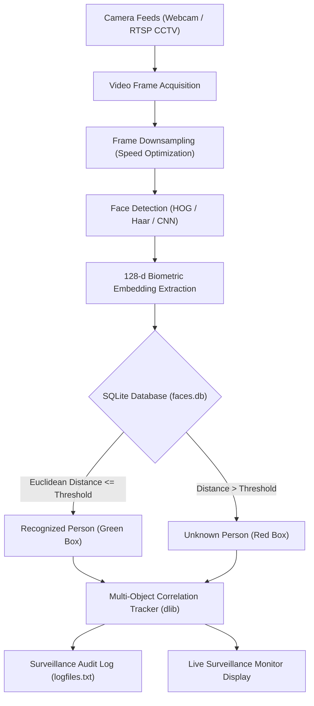

# Person-recognition
A real-time CCTV surveillance system to detect, recognize, and track multiple target individuals across multiple cameras using OpenCV, dlib, and HOG embeddings.


# Real-Time Multiple Person Recognition and Tracking for CCTV Cameras

[](https://www.python.org/)
[](https://opencv.org/)
[](http://dlib.net/)
[](https://www.sqlite.org/)
[](https://www.sih.gov.in/)
[](LICENSE)

> **Smart India Hackathon (SIH) 2019 — Winning Project**  
> An intelligent video surveillance system designed for static and IP CCTV networks to detect, recognize, and track multiple target individuals simultaneously across multiple camera feeds in real time.

---

## 📌 Table of Contents
- [Overview](#-overview)
- [Key Features](#-key-features)
- [System Architecture](#-system-architecture)
- [Project Structure](#-project-structure)
- [Prerequisites & Installation](#-prerequisites--installation)
- [Usage & Execution](#-usage--execution)
  - [1. Database Management & Face Enrollment](#1-database-management--face-enrollment)
  - [2. Live Real-Time Face Recognition](#2-live-real-time-face-recognition)
  - [3. Multi-Camera Tracking](#3-multi-camera-tracking)
  - [4. Web Interface (Flask)](#4-web-interface-flask)
- [Configuration](#-configuration)
- [Tech Stack](#-tech-stack)
- [Troubleshooting](#-troubleshooting)
- [Future Enhancements](#-future-enhancements)
- [Contributing](#-contributing)
- [License](#-license)

---

## 📖 Overview

Standard CCTV surveillance requires human operators to monitor tens or hundreds of video feeds, which is prone to fatigue, delays, and missed targets. This project automates individual identification and tracking across multiple camera viewpoints.

The system combines:
1. **Face Detection & Embedding Extraction**: Detects human faces and extracts 128-dimensional biometric embeddings.
2. **Dynamic Database Matching**: Compares detected faces against an SQLite database using Euclidean distance without requiring full model retraining when new individuals are added.
3. **Correlation Tracking**: Continuously tracks target bounding boxes across multiple camera streams using `dlib` correlation filters to sustain identity continuity even under partial occlusions or changing lighting.
4. **Surveillance Logging**: Automatically logs identification events with timestamp and camera ID.

---

## ✨ Key Features

- **Multi-Person & Multi-Camera Support**: Concurrently detects and monitors multiple individuals across multiple static webcams or RTSP IP camera streams.
- **SQLite Biometric Database**: Fast storage and retrieval of facial encodings (`faces.db`), with instant additions, bulk folder imports, and deletions.
- **Webcam Multi-Gesture Enrollment**: Interactive CLI utility to register individuals by capturing varying facial angles, smiles, and head tilts.
- **Kernel & Correlation Tracking**: Tracks targets between recognition intervals to reduce computational load and maintain real-time performance.
- **Visual Alert System**: Displays green bounding boxes with confidence metrics for recognized identities, and red boxes for unidentified individuals.
- **Automated Event Logging**: Records detection logs (`logfiles.txt`) containing person name, camera ID, similarity metric, and timestamps.
- **Flask Web Interface**: Lightweight backend support for web-based surveillance trigger controls.

---

## 🏗️ System Architecture



---

## 📁 Project Structure

```text
├── faces.db                   # SQLite database storing registered face encodings
├── requirements.txt           # Project Python dependencies
├── README.md                  # Comprehensive project documentation
└── src2/
    ├── manage_database.py     # Interactive CLI to add, import, list, and delete faces
    ├── recognize_live.py      # Real-time live camera recognition with visual HUD
    ├── Continuous.py          # Continuous recognition and timestamped surveillance logging
    ├── Multiple_tracking.py   # Multi-person tracking across video streams
    ├── Multicamera_ob.py      # Multi-camera correlation tracking module
    ├── detect_face_live.py    # OpenCV Haar cascade face extraction utility
    ├── Face_cascade.xml       # Pre-trained Haar Cascade model for frontal face detection
    ├── main.py                # Flask application for web integration
    ├── accucary.py            # Accuracy measurement and evaluation script
    └── kernal.py              # Kernel-based similarity and tracking experiments
```

---

## ⚙️ Prerequisites & Installation

### 1. System Requirements
- **OS**: Windows 10/11, Ubuntu 18.04+, or macOS
- **Python**: Python 3.8 to 3.11 recommended
- **C++ Compiler & CMake** *(required for `dlib`)*:
  - **Windows**: Install [Visual Studio Build Tools](https://visualstudio.microsoft.com/visual-cpp-build-tools/) (select "Desktop development with C++") and [CMake](https://cmake.org/download/).
  - **Ubuntu/Debian**:
    ```bash
    sudo apt update
    sudo apt install -y build-essential cmake libopenblas-dev liblapack-dev libx11-dev libgtk-3-dev
    ```

### 2. Clone the Repository
```bash
git clone https://github.com/<your-username>/Real-Time-Multiple-Person-Recognition-and-Tracking-for-CCTV-Camera.git
cd Real-Time-Multiple-Person-Recognition-and-Tracking-for-CCTV-Camera
```

### 3. Create a Virtual Environment
```bash
# Windows
python -m venv venv
venv\Scripts\activate

# Linux / macOS
python3 -m venv venv
source venv/bin/activate
```

### 4. Install Dependencies
```bash
pip install --upgrade pip setuptools wheel
pip install -r requirements.txt
```

> **Tip for Windows `dlib` installation:** If installing `dlib` fails from PyPI, install via pre-compiled wheel or conda:
> ```bash
> pip install cmake
> pip install dlib
> ```

---

## 🚀 Usage & Execution

### 1. Database Management & Face Enrollment
Use the interactive database manager to register target individuals:

```bash
cd src2
python manage_database.py
```

You will be presented with an interactive menu:
```text
================ FACE DATABASE MANAGER ================
1. View all registered persons
2. Add a new person (Single Image File)
3. Capture Multi-Gesture Samples via Webcam
4. Bulk import photos from a folder
5. Delete a specific person by name
6. Clear ALL records (Empty Database)
7. Start Live Camera Verification
8. Exit
=======================================================
```

- **Option 2 (Single Image)**: Provide the name and path to an image file (e.g., `images/john.jpg`).
- **Option 3 (Webcam Enrollment)**: Opens your webcam to capture multiple face angles/gestures. Press `SPACE` to snap a gesture, and `q` to finish.
- **Option 4 (Bulk Import)**: Provide a directory of pictures formatted as `FirstName_LastName.jpg`.

---

### 2. Live Real-Time Face Recognition
To start live face detection and recognition on your primary camera:

```bash
python recognize_live.py
```
- **Controls**: Press `q` to quit the video stream.
- **HUD Indicator**:
  - 🟩 **Green Bounding Box**: Registered person with name and distance confidence score.
  - 🟥 **Red Bounding Box**: Unknown individual.

---

### 3. Multi-Camera Tracking
For multi-camera or multi-target continuous tracking:

```bash
python Multicamera_ob.py
# or
python Multiple_tracking.py
```
*(Ensure camera indices or RTSP URLs are configured for your network cameras in the script).*

---

### 4. Web Interface (Flask)
To run the lightweight web service:

```bash
python main.py
```
Open your browser and navigate to: `http://localhost:8080`

---

## 🔧 Configuration

### Changing Camera Sources
In `recognize_live.py`, `Continuous.py`, or `Multiple_tracking.py`, update the `cv2.VideoCapture()` source:

```python
# Default built-in webcam:
video_capture = cv2.VideoCapture(0)

# Secondary USB camera:
video_capture = cv2.VideoCapture(1)

# RTSP IP CCTV Camera Stream:
video_capture = cv2.VideoCapture("rtsp://<username>:<password>@<camera_ip>:<port>/stream1")
```

### Adjusting Match Tolerance
In `recognize_live.py` or `manage_database.py`:
- `distance_threshold = 0.60` (Default): Balanced precision and recall.
- `distance_threshold = 0.50`: Strict matching (fewer false positives, requires clearer view).
- `distance_threshold = 0.65`: Loose matching (works under poor lighting or distant faces).

---

## 🛠️ Tech Stack

| Component | Technology | Description |
|---|---|---|
| **Language** | Python 3 | Core logic and pipeline implementation |
| **Computer Vision** | OpenCV (`cv2`) | Video frame capture, image preprocessing, and rendering |
| **Face Recognition** | `face_recognition` / `dlib` | 128-dimensional facial embeddings using deep metric learning |
| **Object Tracking** | `dlib.correlation_tracker` | Real-time visual tracking of target bounding boxes |
| **Database** | SQLite3 | Local serverless storage for facial embeddings |
| **Web Framework** | Flask | REST endpoints and web GUI interface |
| **Analytics & ML** | Scikit-learn, NumPy | Distance computations and classification metrics |

---

## 🔍 Troubleshooting

- **Webcam cannot open / `cv2.VideoCapture` returns None**:
  - Verify webcam index (`0`, `1`, etc.) or check camera access permissions in your OS settings.
- **`No module named 'face_recognition'` / `dlib` compilation error**:
  - Ensure CMake is installed and added to your system `PATH`.
  - On Windows, install the C++ build tools via the Visual Studio Installer.
- **Lag or Low FPS**:
  - Frames are downsampled by default (1/4 scale) during detection to maximize FPS.
  - Alternate frame skipping is enabled in `recognize_live.py` for smooth playback.

---

## 🔮 Future Enhancements

- [ ] Upgrade object tracker to **DeepSORT** / **ByteTrack** with body Re-ID features.
- [ ] Incorporate **YOLOv8-Face** / **YOLOv11** for long-distance and crowded scene detection.
- [ ] Multi-threaded video stream decoding to eliminate frame buffering delays.
- [ ] Centralized PostgreSQL/Cloud database synchronization for multi-node deployments.
- [ ] Push notifications / Telegram bot alerts when high-priority targets are sighted.

---

## 🏆 Acknowledgments

- **Smart India Hackathon 2019** — Developed and awarded as the Winning Solution for the problem statement on smart surveillance.
- Built on top of open-source libraries: [Adam Geitgey's face_recognition](https://github.com/ageitgey/face_recognition), [dlib](http://dlib.net/), and [OpenCV](https://opencv.org/).

---

## 📄 License

This project is licensed under the MIT License — feel free to modify and use it for educational and research purposes.
